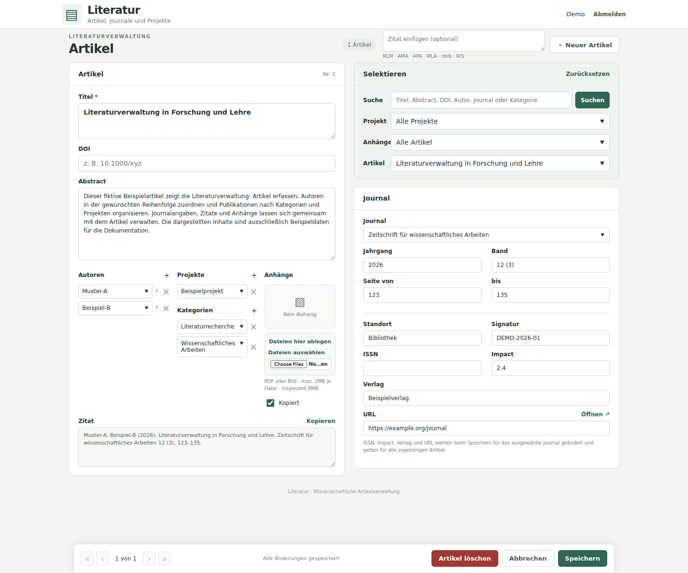

# Literatur

Browseroberfläche für die eine Literaturdatenbank mit MySQL als Backend.



*Weboberfläche mit fiktiven Beispieldaten.*

## Anmeldung und Benutzerverwaltung

Artikelverwaltung und Anhangszugriff erfordern eine Anmeldung. Sitzungen laufen nach einer Stunde Inaktivität ab; „Abmelden“ beendet den angemeldeten Zugriff.

User erstellen und Passwort auf dem Server im Projektverzeichnis setzen oder ändern:

```bash
php bin/set-password.php username
```

Das Programm fragt das Passwort zweimal ab. Es muss mindestens 8 Zeichen lang sein. In einer interaktiven Shell bleibt die Eingabe verborgen. Gespeichert wird ein Passwort-Hash in `.private/users.json`. Weitere Benutzer können mit demselben Befehl und einem anderen Benutzernamen eingerichtet werden.

Nach acht fehlgeschlagenen Anmeldeversuchen innerhalb des Sperrzeitraums werden weitere Versuche für die jeweilige Kombination aus IP-Adresse und Benutzername vorübergehend gesperrt. Die Anmeldeprüfung verwendet einen Zeitraum von 15 Minuten.

## Bedienung

- **Suchen und auswählen:** Suche in Titel, Abstract, DOI, Autorennamen, Journalnamen und zugeordneten Kategorien; zusätzlich nach Projekt filtern und einen Artikel auswählen. Die Projektauswahl zeigt bei jedem Projekt die Gesamtzahl seiner gespeicherten Artikel, auch bei leerem Bestand und unabhängig vom Suchtext. Unterstützende Browser richten die Zahlen rechts aus; sonst erscheinen sie direkt hinter dem Projektnamen.
- **Artikel ohne Projekt finden:** Im Projektfilter „Ohne Projekt“ auswählen. Die Auswahl zeigt ausschließlich Artikel ohne jede Projektzuordnung und lässt sich mit der Textsuche kombinieren. Die Zahl daneben ist die Gesamtzahl der Artikel ohne Projekt, unabhängig vom Suchtext. Neue Artikel erhalten bei dieser Auswahl keine Projektvorbelegung.
- **Artikel ohne Anhänge finden:** Unter „Selektieren“ im Feld „Anhänge“ die Option „Ohne Anhänge“ auswählen. Sie zeigt ausschließlich Artikel ohne gespeicherte Anhänge. „Ohne Anhänge und nicht kopiert“ schränkt zusätzlich auf Artikel ein, bei denen „Kopiert“ nicht markiert ist. Beide Optionen lassen sich mit der Suche und dem Projektfilter kombinieren. „Alle Artikel“ hebt diesen Filter auf. Die Auswahl bleibt beim Navigieren und Speichern erhalten; „Zurücksetzen“ entfernt alle Filter.
- **Leere Projekte löschen:** Bei einem ausgewählten Projekt mit 0 Artikeln erscheint neben der Projektauswahl „Projekt löschen“. Die Bestätigungsseite zeigt den Projektnamen; erst „Endgültig löschen“ entfernt das Projekt. Die Bestätigung gilt zehn Minuten. Beim Löschen werden Name und Artikelzuordnungen erneut geprüft; geänderte oder inzwischen belegte Projekte werden nicht gelöscht. Anschließend wird der Projektfilter zurückgesetzt.
- **Navigieren und speichern:** Die Navigationsleiste bleibt am unteren Fensterrand sichtbar. Sie enthält Blätterfunktionen, Speicherstatus sowie die verfügbaren Aktionen Löschen, Abbrechen und Speichern. Ein automatisch angepasster Abstand hält die letzten Formularfelder frei. Auf schmalen Bildschirmen wird die Leiste mehrzeilig.
- **Artikel erfassen:** „Neuer Artikel“ öffnet ein Formular. Das im Suchfilter ausgewählte Projekt wird vorbelegt; bei „Alle Projekte“ bleibt die Zuordnung leer. Erst „Speichern“ legt den Artikel an.
- **Artikel bearbeiten:** Titel, DOI, Abstract, Journal, Jahrgang, Band, Seiten, Standort, Signatur und Kopiert-Status bearbeiten. Autoren, Kategorien und Projekte können ausgewählt oder ergänzt werden; neue Journale werden über die Journalauswahl erfasst.
- **Journalangaben bearbeiten:** ISSN, Impact, Verlag und URL sind bei einem ausgewählten Journal editierbar. „Speichern“ übernimmt die Änderungen am Journal gemeinsam mit dem Artikel; sie gelten für alle Artikel dieses Journals. Zwischenzeitliche Änderungen am Journal verhindern das Überschreiben. Ohne ausgewähltes Journal sind diese vier Felder deaktiviert.
- **Kompakte Auswahllisten:** Autoren, Kategorien, Projekte, Journale und Artikel verwenden dieselbe kompakte native Dropdown-Darstellung. Bei Zuordnungen öffnet „＋ Neu erfassen“ ein Eingabefeld für einen neuen Namen; „＋“ ergänzt eine weitere Zuordnung. Neue Einträge entstehen erst beim Speichern.
- **Autoren sortieren:** Der Pfeil nach oben verschiebt einen Autor in der Reihenfolge. Gleichnamige Autoren bleiben getrennte Einträge; Auswahlvorschläge kennzeichnen sie mit ihrer ID.
- **Zitat verwenden:** Die Zitierhilfe übernimmt die Formularwerte und die sichtbare Autorenreihenfolge. „Kopieren“ kopiert das Zitat oder markiert den Text, wenn der Browser den Zwischenablagezugriff verweigert.
- **DOI öffnen:** „Artikel öffnen ↗“ öffnet eine gültige DOI über `https://doi.org/` in einem neuen Tab. Auch Angaben mit `doi:` und vollständige doi.org-URLs werden erkannt. Das DOI-Feld ist optional und erlaubt höchstens 255 Zeichen.
- **Artikel löschen:** „Artikel löschen“ zeigt eine Bestätigungsseite mit Titel, Artikelnummer und Anhangsanzahl. Erst „Endgültig löschen“ entfernt den Artikel samt Anhängen und Zuordnungen. Autoren, Journale, Kategorien und Projekte bleiben erhalten. Die Bestätigung gilt zehn Minuten; zwischenzeitliche Änderungen verhindern das Löschen.

Änderungen werden erst beim Speichern übernommen. Die Oberfläche kennzeichnet ungespeicherte Änderungen und fragt bei einem Wechsel zu anderen Artikeln, Filtern oder einem neuen Entwurf nach.

## Zitatimport

Links neben „Neuer Artikel“ kann ein Zitattext eingefügt werden. Beim Klick auf den Button werden NLM, AMA, APA, MLA, nbib und RIS anhand ihrer Struktur erkannt. Titel, DOI, Autoren, Journal, Jahr, Band/Heft und Seiten werden soweit möglich übernommen. nbib und RIS können zusätzlich Abstract, ISSN und Verlag liefern. Ein leeres Zitatfeld öffnet ein leeres Formular mit der Projektvorbelegung.

Der Import verarbeitet einen Artikel lokal auf dem Server. Die übernommenen Werte und Hinweise müssen vor dem Speichern geprüft werden. NLM und AMA können identisch aussehen und werden dann gemeinsam als „NLM / AMA“ angezeigt. Gekürzte Autorenlisten wie `et al.` werden nicht vervollständigt.

Autoren werden in die Schreibweise `Familienname-Initialen` überführt. Eindeutig passende Stammdaten behalten ihre IDs. Bei mehrfach vorhandenen Namen ist der richtige Eintrag auszuwählen. Journaltitel und Abkürzungen werden bei eindeutiger Übereinstimmung zugeordnet; andernfalls wird ein neues Journal vorgeschlagen.

Die Seitenfelder unterstützen nur ganze Zahlen. Angaben wie `e12345` oder `S12–S19` erzeugen einen Hinweis; der Originaltext bleibt im Entwurf sichtbar. Numerisch verkürzte Bereiche wie `123–9` werden zu `123–129` erweitert. Bis zu zehn Importentwürfe werden für eine Stunde in der Sitzung gehalten. Neue Stammdaten und Artikel entstehen erst beim Speichern.

## Anhänge

PDF, JPEG, PNG, GIF, WebP und TIFF können über „Dateien auswählen“ oder per Drag&Drop hinzugefügt werden. Mehrere Auswahlvorgänge werden gesammelt. Vorgemerkte Dateien können vor dem Speichern wieder entfernt werden.

- Höchstens 10 MiB je Datei: 10.485.760 Bytes, in der Oberfläche als 10 MB bezeichnet.
- Bis zu 20 neue Dateien je Speichervorgang, zusätzlich begrenzt durch PHPs `max_file_uploads`.
- Für alle Dateien und Formularfelder zusammen gilt die PHP-Grenze `post_max_size=25M`.
- `.htaccess` setzt für Apache `upload_max_filesize=10M` und `post_max_size=25M`. Andere PHP-Ausführungsarten können abweichende Grenzen verwenden.

Neue Dateien werden erst mit dem Artikel gespeichert. Bestehende Anhänge lassen sich öffnen oder herunterladen. TIFF wird heruntergeladen. Zum Löschen eines Anhangs „Entfernen“ markieren und den Artikel speichern. Downloads prüfen Artikelzuordnung, Dateigröße, SHA-256 und Dateityp.

## Konfiguration und Betrieb

Die Anwendung verwendet PHP mit `pdo_mysql` und `mbstring` sowie MySQL ab Version 8.0.16 (Fensterfunktionen und wirksame `CHECK`-Constraints). Auf diesem Server läuft PHP 8.5. Es gibt keinen Build-Schritt und keine Composer- oder npm-Installation.

Für eine Neuinstallation erstellt `schema.sql` die leere Datenbank `Literatur` mit allen neun Anwendungstabellen, Indizes und Fremdschlüsseln:

```bash
mysql -u BENUTZER -p < schema.sql
```

Der verwendete MySQL-Benutzer benötigt die Berechtigungen zum Erstellen der Datenbank und ihrer Tabellen. Bei einem anderen Datenbanknamen `CREATE DATABASE` und `USE` in `schema.sql` sowie `APIARY_DB_NAME` in `.env` anpassen. Die Datei enthält keine Artikel, Anhänge, Zugangsdaten oder historischen Import- und Sicherungstabellen. Sie ist für eine neue Installation vorgesehen; vorhandene Tabellen werden weder ersetzt noch migriert. Die ID-Vergabe beginnt bei 1.

Die Datenbankverbindung wird aus `.env` gelesen:

```ini
APIARY_DB_HOST=...
APIARY_DB_NAME=Literatur
APIARY_DB_USER=...
APIARY_DB_PASS=...
```

Apache muss `.htaccess` auswerten (`AllowOverride All`) und `mod_rewrite` laden. Beides ist auf diesem Server eingerichtet. Die Upload-Einstellungen verwenden das Apache-PHP-Modul. HTTPS wird durch die vorhandene Serverkonfiguration erzwungen; das PHP-Bootstrap prüft HTTPS zusätzlich. Die Anwendung verwendet die Zeitzone `Europe/Vienna`.

Versteckte Dateien und Verzeichnisse einschließlich `.env` und `.private` sowie `app` und `bin` sind über HTTP gesperrt. Auch README, Screenshot, mögliche Artikel-Importquellen und Sicherungsdateien sind gesperrt. Verzeichnislisten und MultiViews sind deaktiviert. Zusätzliche `.htaccess`-Sperren liegen in `app`, `bin` und `.private`.

PHP benötigt Lesezugriff auf `.env` und Schreibzugriff auf `.private` sowie die dortigen Benutzer- und Anmeldeprüfungsdateien. Die Anwendung verwendet CSRF-Prüfungen, vorbereitete SQL-Abfragen und Passwort-Hashes.


## Dateien und Bereinigung

| Pfad | Verwendung |
|---|---|
| `index.php` | Anmeldung und Artikeloberfläche |
| `attachment.php` | Geschützter Anhangszugriff |
| `app/` | PHP-Module |
| `assets/` | CSS und JavaScript |
| `.env` | Datenbankverbindung |
| `.htaccess` | Apache-Zugriffsschutz und Upload-Grenzen |
| `.private/users.json` | Benutzer und Passwort-Hashes |
| `.private/login-attempts.json` | Fehlgeschlagene Anmeldeversuche und Sperren |
| `.private/.htaccess` | Zugriffssperre für private Dateien |
| `bin/set-password.php` | Passwortverwaltung über die Kommandozeile |
| `schema.sql` | Leere MySQL-Datenbank mit Anwendungsschema erstellen |
| `Capture.PNG` | Ursprünglicher Access-Screenshot; optional |
| `README.md` | Diese Dokumentation; optional für den Betrieb |
